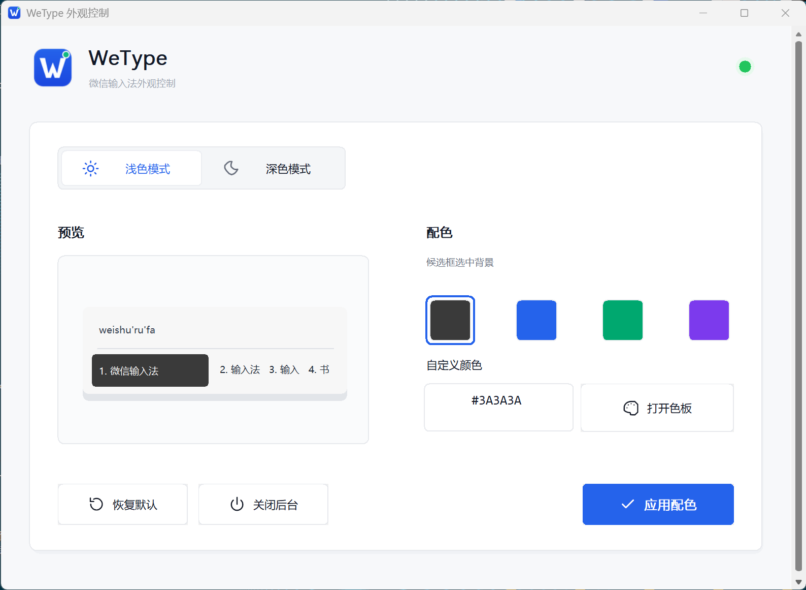
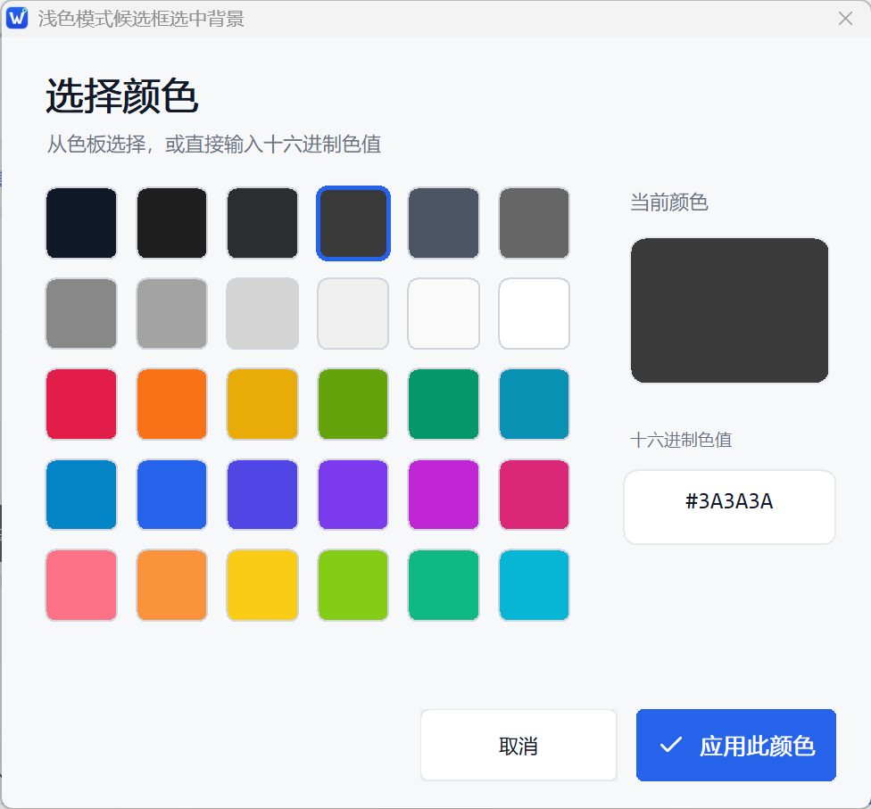
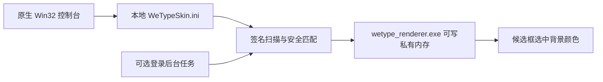

<div align="center">
  
  <h1>微信输入法候选框颜色控制台</h1>
  <p><strong>WeChat / WeType Candidate Color Console for Windows</strong></p>
  <p>一个轻量、原生、可审查的 Windows 工具，用来调整微信输入法候选框的选中背景颜色。</p>

  [](https://github.com/Rural-Dynamics/wechat-wetype-candidate-color-console/releases/latest)
  [](#兼容性)
  [](#从源码构建)
  [](LICENSE)
</div>



> [!WARNING]
> **非官方项目。** 本项目与腾讯、微信、WeChat 或微信输入法团队没有关联，也未获得其认可。项目不包含腾讯源代码、二进制文件或官方图标。程序通过读取和修改 `wetype_renderer.exe` 的可写进程内存实现颜色替换，使用前请先阅读[风险与免责声明](#风险与免责声明)。

## 它能做什么

- 分别设置浅色模式、深色模式下的候选项选中背景色
- 提供常用配色、完整色板和十六进制颜色输入
- 在应用前直接预览候选框效果
- 可选登录后台监控，在输入法进程重启后自动恢复配色
- 原生 Win32/C++ 实现，不依赖 WebView、Java 或额外运行时
- 无网络通信、遥测、账号系统或输入内容采集

## 界面预览

| 主控制台 | 自定义色板 |
| --- | --- |
| 设置浅色/深色候选框颜色，预览后应用 | 从色板选择或直接输入十六进制色值 |
|  |  |

## 立即使用

前往 **[Releases 下载最新版](https://github.com/Rural-Dynamics/wechat-wetype-candidate-color-console/releases/latest)**。普通用户推荐下载 `WeTypeSkin-v1.0.0-portable.zip`。

1. 下载便携版 ZIP，并完整解压到一个可长期保留的目录。
2. 双击 `WeTypeSkinLauncher.exe`。
3. 选择“浅色模式”或“深色模式”，再选择预设颜色或输入 `#RRGGBB` 色值。
4. 查看候选框预览，确认后点击“应用配色”。
5. 如果需要输入法重启后自动恢复颜色，以管理员身份运行 `install-wetype-native-task.ps1`。

停止或卸载后台任务：

- 临时停止：在控制台点击“关闭后台”。
- 完全移除：以管理员身份运行 `uninstall-wetype-native-task.ps1`。

程序会在同目录生成 `WeTypeSkin.ini`。它可能包含当前进程 PID、临时内存地址和运行状态，请勿公开分享该文件。

## 兼容性

| 项目 | 当前状态 |
| --- | --- |
| Windows | Windows 11 x64 已测试 |
| 微信输入法 | `2.1.2.11` 已测试 |
| 微信输入法 | `3.0.0.38` 已验证候选词背景签名，文字签名需在首个候选词实际渲染时复核 |
| 其他版本 | 可能可用，但不作兼容保证 |
| 管理员权限 | 应用补丁及安装后台任务时可能需要 |
| 数字签名 | 当前发布文件尚未签名，SmartScreen 可能提示未知发布者 |

输入法更新后，颜色签名或进程结构可能变化。程序找不到唯一兼容签名时会停止写入，不应通过反复强制运行来绕过保护。

## 工作原理



补丁引擎仅扫描目标进程的可写私有内存区域，并通过匹配数量上限避免在结果含糊时继续写入。进程重启后，旧地址会失效，程序会重新扫描。

## 从源码构建

要求：Windows x64、PowerShell 5.1+、支持 C++17 的 MinGW-w64。推荐使用 [w64devkit](https://github.com/skeeto/w64devkit)，并确保 `g++.exe` 和 `windres.exe` 位于 `PATH`。

```powershell
git clone https://github.com/Rural-Dynamics/wechat-wetype-candidate-color-console.git
cd wechat-wetype-candidate-color-console
powershell -ExecutionPolicy Bypass -File .\build.ps1
```

输出文件位于 `build\WeTypeSkinLauncher.exe`。项目使用静态链接，运行时不需要额外安装 MinGW DLL。

## 为二次开发者准备

核心项目保持小型、直接，便于审查和重构：

| 文件 | 作用 |
| --- | --- |
| `WeTypeSkinLauncher.cpp` | Win32 UI、配置、监控和内存补丁逻辑 |
| `WeTypeSkin.rc` / `WeTypeSkin.ico` | Windows 版本资源和原创应用图标 |
| `WeTypeSkin.example.ini` | 不含本机运行状态的公开配置模板 |
| `build.ps1` | 可复现的 MinGW-w64 构建入口 |
| `install-wetype-native-task.ps1` | 用户主动安装登录后台任务 |
| `uninstall-wetype-native-task.ps1` | 停止并移除后台任务 |

欢迎围绕以下方向重构：

- 将 UI、配置、签名扫描和任务管理拆分为可测试模块
- 建立按微信输入法版本选择的签名清单
- 增加只扫描不写入的诊断模式和自动化测试
- 完善高 DPI、无障碍、键盘导航和多语言支持
- 在不增加常驻资源开销的前提下改进界面

任何重构都必须保留三个安全边界：**目标进程名称校验、匹配数量上限、签名不明确时拒绝写入**。开始贡献前请阅读 [CONTRIBUTING.md](CONTRIBUTING.md)。

## 隐私与安全

- 不联网，不包含 API，不上传数据
- 不记录或读取用户输入内容
- 不包含腾讯源代码、输入法二进制或官方资源
- `WeTypeSkin.ini`、日志、构建目录和 EXE 不进入 Git 源码历史
- Release 同时提供 SHA-256 校验文件

如果发现安全问题或疑似敏感信息，请按照 [SECURITY.md](SECURITY.md) 处理，不要在公开 Issue 中粘贴日志、配置文件、PID、内存地址、IP、令牌或个人路径。

## 风险与免责声明

本软件按“原样”提供，不承诺适用于任何特定微信输入法版本。它会访问另一个进程的内存，可能被 Windows Defender、SmartScreen 或第三方安全软件警告。输入法升级、系统策略变化或安全软件拦截都可能导致功能失效。

使用者应自行评估风险并对系统和数据负责。作者和贡献者不对因使用、误用、兼容性变化或第三方软件更新造成的损失承担责任。请勿将本项目用于绕过付费功能、账号限制、数字版权管理或其他访问控制。

微信、WeChat、微信输入法及相关名称和标识属于其各自权利人。本项目名称中的相关文字仅用于说明兼容对象。

## MIT 开源协议

本项目采用宽松的 **[MIT License](LICENSE)**：允许使用、复制、修改、合并、发布和再分发，但必须保留原始版权与许可证声明。MIT 许可证不代表腾讯或任何第三方对本项目作出授权、认可或担保。

## 参与项目

- 遇到兼容问题：提交 Issue，并只提供输入法版本、Windows 版本和去敏后的状态说明
- 提出界面或架构方案：先说明目标、运行开销和安全边界
- 提交代码：保持改动小而可验证，不提交本机配置、日志或编译产物

欢迎 Star、Fork、Issue 和 Pull Request。
